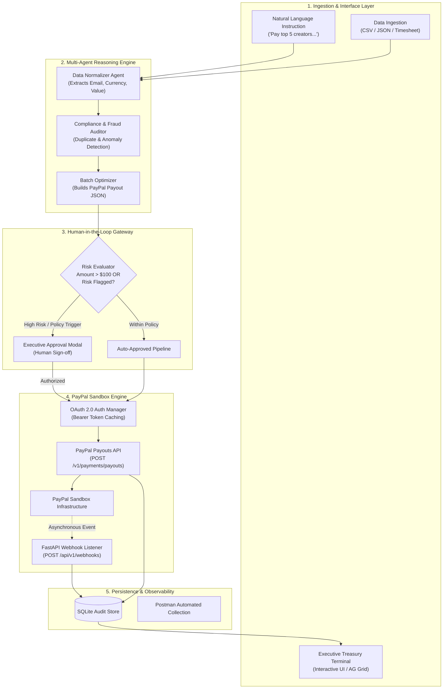
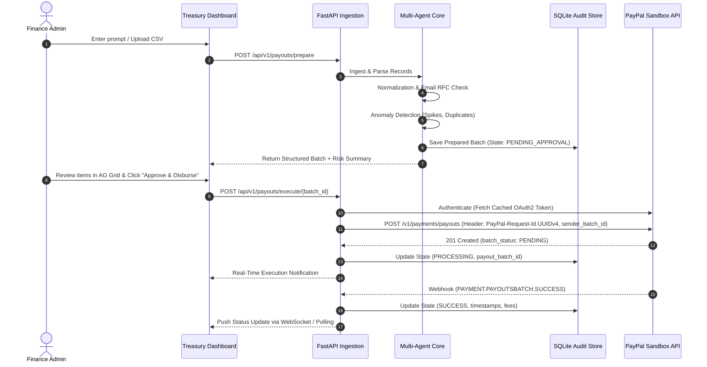

# SYSTEM ARCHITECTURE: PayPilot AI
## Autonomous Agentic Treasury & Multi-Party Payout Engine

---

## 1. Executive Summary & Hackathon Strategy

### 1.1 The Target Problem
Global payouts for marketplaces, affiliate networks, creator platforms, and distributed teams remain a massive operational bottleneck. Businesses disburse billions annually via fragmented spreadsheets, manual calculations, and error-prone administrative dashboards. This introduces three severe failure modes:
1. **Fat-Finger & Duplicate Errors:** High-volume batch payouts frequently double-pay recipients or disburse to mistyped addresses.
2. **Compliance & Fraud Latency:** Lack of pre-disbursal anomaly screening results in unauthorized or threshold-violating transactions.
3. **Operational Drag:** Gathering multi-source performance data (e.g. hackathon winners, gig shifts, affiliate commissions) and converting it into validated payment orders takes hours of manual formatting.

### 1.2 Our Solution: PayPilot AI
**PayPilot AI** is an autonomous, multi-agent financial operations engine that ingests unstructured natural language or raw tabular records, executes strict deterministic compliance audits, and dispatches multi-party disbursements via the **PayPal Payouts REST API** with an asynchronous **Webhook Feedback Loop** and an explicit **Human-in-the-Loop (HITL) Safety Gate**.

### 1.3 Engineering the Competitive Edge
Grounded in our Phase 1 reconnaissance, PayPilot AI directly fulfills the five hackathon evaluation pillars:
- **Technological Implementation:** Dual integration of PayPal Payouts API and asynchronous Webhook event listeners, orchestrated by a multi-agent state graph with Pydantic-enforced financial contracts and idempotent batch tracking.
- **Design & Polish:** Modern executive treasury dashboard featuring an interactive data grid (incorporating sponsor AG Grid / Postman paradigms) for real-time auditability.
- **Potential Impact:** Solves high-friction enterprise and SME cash disbursement with measurable ROI (sub-second batch construction vs. manual multi-hour processing).
- **Innovation:** Transitioning commerce from passive "pay-me" buttons to active, autonomous agentic fund distribution with risk-scored approvals.
- **Sponsor Tracks:** Out-of-the-box support for **Postman** (complete API collection and test environment) and **Render** (one-click `render.yaml` deployment specification).

---

## 2. Tech Stack & Justification

| Layer | Technology | Selection Rationale & Advantages |
| :--- | :--- | :--- |
| **Language** | Python 3.11+ (Detected: 3.15) | Industry standard for financial AI, data processing, and enterprise SDK support. |
| **API Framework** | **FastAPI** + **Uvicorn** | High-throughput asynchronous performance, native Pydantic integration, automatic OpenAPI/Swagger documentation, and native async webhook endpoints. |
| **Agent / Orchestration** | **LangChain / LangGraph** + **Pydantic v2** | Enforces deterministic schema validation over probabilistic LLM output; provides state machine support for Human-in-the-Loop pause/resume states. |
| **LLM Inference** | **OpenAI / Anthropic / Gemini API** (Flexible Router) | Multi-model routing allowing low-latency entity extraction (e.g. GPT-4o-mini / Claude 3.5 Haiku) with zero vendor lock-in. |
| **Financial Engine** | **PayPal Payouts REST API v1** + **Webhooks** | Official PayPal sandbox-verified disbursal engine utilizing OAuth2 token caching, batch status polling, and asynchronous event callbacks. |
| **Persistence** | **SQLite** + **SQLAlchemy (Async)** | Zero-overhead, transactional ACID storage for batch states, individual disbursal items, webhook audit events, and idempotency keys. |
| **Interactive UI** | **FastAPI + Modern Web Dashboard (Tailwind + AG Grid)** | Clean, responsive executive treasury terminal providing dense financial auditing, batch approval switches, and live event streaming. |
| **DevOps / Sponsors** | **Render** (`render.yaml`) & **Postman** (Collection v2.1) | Direct alignment with hackathon sponsor categories for bonus points and frictionless evaluation. |

---

## 3. System Architecture & Data Flow

### 3.1 Component Architecture Diagram



### 3.2 End-to-End Execution Sequence



---

## 4. Data Contracts & Persistence Schemas

### 4.1 Domain Contracts (Pydantic Models)

```python
from decimal import Decimal, ROUND_HALF_UP
from pydantic import BaseModel, Field, EmailStr, field_validator
from typing import List, Optional
from enum import Enum
from datetime import datetime

class ReceiverType(str, Enum):
    EMAIL = "EMAIL"
    PHONE = "PHONE"
    PAYPAL_ID = "PAYPAL_ID"

class PayoutItem(BaseModel):
    recipient_type: ReceiverType = Field(default=ReceiverType.EMAIL)
    receiver: str = Field(..., description="Email, E.164 Phone, or PayPal Account ID")
    amount: Decimal = Field(gt=0, description="Financial precision via Decimal, strictly positive")
    currency: str = Field(default="USD", min_length=3, max_length=3)
    note: str = Field(default="Disbursement via PayPilot AI")
    sender_item_id: str
    risk_flags: List[str] = Field(default_factory=list)

    @field_validator("currency")
    @classmethod
    def validate_currency_code(cls, v: str) -> str:
        return v.upper()

    def format_amount_for_paypal(self) -> str:
        """Enforces ISO 4217: 0 decimals for JPY/HUF/TWD; exactly 2 decimals for USD/EUR/GBP."""
        if self.currency in ("JPY", "HUF", "TWD"):
            return str(int(self.amount.to_integral_value()))
        return str(self.amount.quantize(Decimal("0.01"), rounding=ROUND_HALF_UP))

class PayoutBatchRequest(BaseModel):
    sender_batch_id: str
    items: List[PayoutItem]
    total_amount: Decimal
    requires_hitl: bool
    risk_score: float = Field(ge=0.0, le=1.0)

class PayoutBatchResponse(BaseModel):
    payout_batch_id: str
    batch_status: str
    sender_batch_id: str
    created_at: datetime
```

### 4.2 SQLite Database Tables
- `batches`: Holds `batch_id`, `sender_batch_id`, `status` (`DRAFT`, `PENDING_APPROVAL`, `SUBMITTED`, `SUCCESS`, `DENIED`), `total_amount`, `currency`, `risk_score`, and timestamps.
- `items`: Holds foreign key `batch_id`, `recipient_type`, `receiver`, `amount`, `currency`, `sender_item_id`, `transaction_id`, `transaction_status`, and `error_message`.
- `webhook_events`: Holds `event_id`, `event_type`, `resource_type`, `summary`, raw JSON `payload`, and received timestamp.

---

## 5. Production Constraints & Evaluation Protocols

### 5.1 Idempotency & Financial Safety
- **Dual-Layer Idempotency:** 
  1. *HTTP Transport Layer:* Every state-mutating API call injects the official `PayPal-Request-Id` header with a unique **UUIDv4** string (max 38 characters).
  2. *Application Resource Layer:* Every batch disbursal defines a deterministic `sender_batch_id`. The PayPal API guarantees that resubmitting a request with an existing `sender_batch_id` returns the existing resource without initiating duplicate fund transfers.
- **Circuit Breaker:** Total single-batch spend capped at a configurable threshold (e.g., \$5,000 Sandbox) with max individual transfers capped at \$1,000 unless explicit multi-signature flag is set.

### 5.2 Secret & Configuration Management
- Secrets are strictly managed via `.env` parsed by `pydantic-settings`.
- Dedicated `.env.example` provides non-sensitive placeholders.
- Absolutely zero hardcoded credentials or sandbox keys committed to git.

### 5.3 Fallback & Resilience Strategy
- **Token Expiry Management:** OAuth2 Bearer tokens are stored in memory with proactive expiration refreshes (5 minutes prior to TTL).
- **Network Retries:** Exponential backoff with jitter on HTTP 429 (Rate Limit) and 5xx PayPal API responses.
- **Malformed Webhook Protection:** Cryptographic or mock-mode verification for webhook payloads to prevent unauthorized state manipulation.

---

## 6. Sponsor Alignment Matrix

| Sponsor Tool | Exact Project Integration |
| :--- | :--- |
| **Postman** | Dedicated `/docs/postman/` directory containing `PayPilot_Sandbox.postman_collection.json` and environment setup for end-to-end sandbox verification. |
| **Render** | Root-level `render.yaml` infrastructure-as-code blueprint for seamless, 1-click cloud deployment of the FastAPI backend and web terminal. |
| **AG Grid** | Web dashboard interface data grid featuring column sorting, filtering, and risk badge formatting for batch transactions. |
