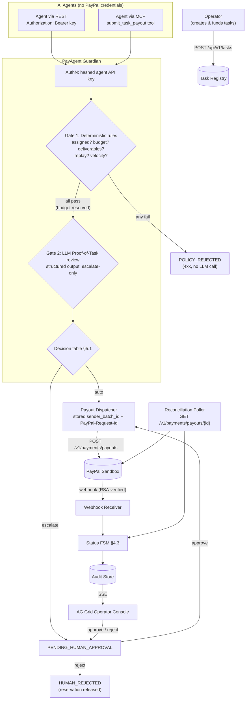
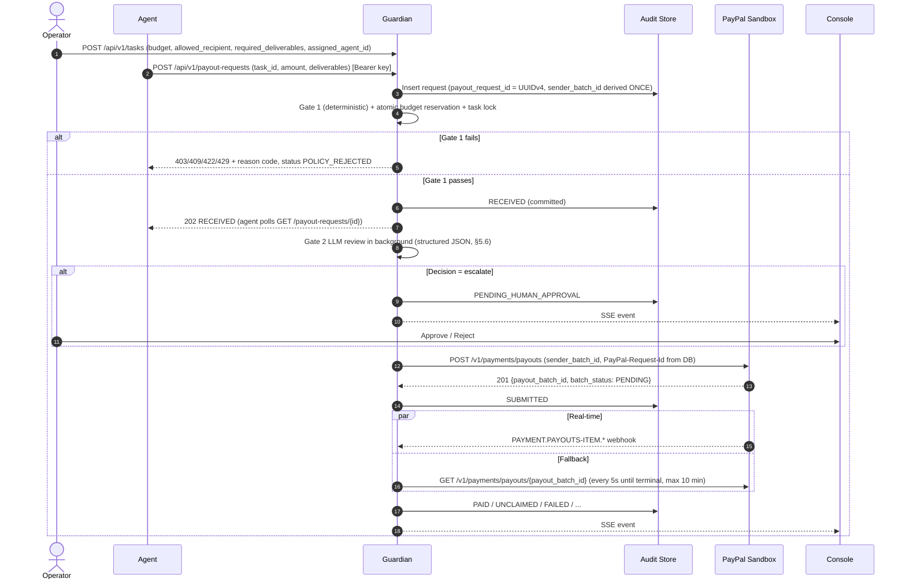

# SYSTEM ARCHITECTURE: PayAgent AI
## Spend-Control Guardian for AI Agents, Settled on PayPal Payouts

> **Revision 2 (pivot locked).** PYUSD is demoted to roadmap (§9). PayPal Payouts v1 is the only settlement rail.
> Decisions captured here are canonical; if another file disagrees, this file wins and the other file is a bug.

---

## 1. Problem, Audience & Solution

### 1.1 Problem
Teams are starting to let AI agents complete paid work: closing bounties, labeling data, reviewing code. Paying for that work today forces a bad choice:
1. **Give the agent payment credentials** → runaway spend from loops, hallucinated duplicates, or prompt injection that redirects funds.
2. **Approve every payout by hand** → the human becomes the bottleneck the agent was meant to remove.

### 1.2 Audience
**Operators** (a small engineering team, open-source maintainer, or data-ops lead) who post paid tasks that AI agents fulfil, and who pay the agent's owner or a contractor through PayPal.

### 1.3 Solution
PayAgent is the **only component that holds PayPal credentials**. Agents never see them. An agent can only ask to be paid **against a task the operator already funded**, to **the recipient the operator already chose**, for **at most the budget the operator already set**. Inside that envelope, PayAgent decides whether to pay instantly or escalate to a human.

| Who decides | What |
| :--- | :--- |
| Operator (task registry) | Task, budget, allowed recipient, required deliverables, assigned agent |
| Agent | *Only* which task it claims and the deliverables it submits |
| Guardian Gate 1 (deterministic code) | Hard reject — LLM never invoked |
| Guardian Gate 2 (LLM) | Can **escalate** to a human, can **never** approve beyond Gate 1 |
| Human (dashboard) | Approve or reject escalated requests |

---

## 2. Tech Stack

| Layer | Technology | Notes |
| :--- | :--- | :--- |
| Language | Python 3.11 | Matches `render.yaml` `PYTHON_VERSION`. |
| API | FastAPI + Uvicorn (**single worker**) | Single worker is a documented assumption of the budget-reservation design (§5.3). |
| Agent interface | REST **and** an MCP server exposed by PayAgent (`mcp` Python SDK) | Lets any MCP-capable agent request payment without custom glue (§6.5). |
| Proof-of-Task review | `openai` SDK structured outputs against any OpenAI-compatible endpoint (Gemini `gemini-3.5-flash-lite` default; OpenAI via `LLM_BASE_URL`) | One structured call. LangGraph is **not** used — there is no multi-step graph to justify it. |
| Settlement | PayPal Payouts v1 (`POST /v1/payments/payouts`, `GET /v1/payments/payouts/{id}`) | USD only in v1. |
| Status updates | PayPal webhooks (RSA-verified) **+** reconciliation poller | Poller is the source of truth when no public URL exists (local judging). |
| Persistence | SQLAlchemy async; **SQLite default**, Postgres optional via `DATABASE_URL` | Judges run locally with zero setup; hosted demo may point at a persistent Postgres (e.g. Neon). |
| Dashboard | Static HTML + AG Grid Community, live updates via **SSE** | No frontend build step. |
| Sponsor tools | AG Grid, Postman, Render | See §8. |

---

## 3. Component Flow



### 3.1 Sequence



---

## 4. Data Model

### 4.1 Tables

| Table | Key columns |
| :--- | :--- |
| `agents` | `agent_id`, `name`, `api_key_hash` (SHA-256), `status` (`ACTIVE`/`QUARANTINED`), `hourly_cap` |
| `tasks` | `task_id`, `title`, `acceptance_criteria`, `budget`, `currency='USD'`, `allowed_recipient`, `assigned_agent_id`, `required_deliverables` (JSON list), `deadline`, `status` |
| `payout_requests` | `payout_request_id` (UUIDv4 PK), `task_id`, `agent_id`, `amount`, `deliverables` (JSON), `artifact_sha256`, `status`, `decision_reasons` (JSON), `llm_verdict` (JSON), `risk_score` (display only), `sender_batch_id` (UNIQUE), `paypal_request_id` (UNIQUE), `payout_batch_id`, `created_at`, `decided_by` |
| `payout_items` | `payout_item_id`, `payout_request_id`, `transaction_status` (raw PayPal value), `transaction_id`, `errors` (JSON), `updated_at` |
| `budget_windows` | `agent_id`, `window_start` (hour bucket), `reserved`, `spent` — PK (`agent_id`, `window_start`) |
| `webhook_events` | `event_id` (UNIQUE — dedupe), `event_type`, `resource_id`, `verified` (bool), `source` (`paypal`/`simulated`), `raw` (JSON), `received_at` |
| `agent_incidents` | `agent_id`, `reason_code`, `payout_request_id`, `created_at` — feeds the circuit breaker |

`artifact_sha256` is computed **server-side** over the canonical JSON of `deliverables`; agents do not supply it.

### 4.2 Core Schemas (contract, not implementation)

```python
class Task(BaseModel):
    task_id: str
    title: str
    acceptance_criteria: str
    budget: Decimal                      # USD, >0, at most 2 dp; validator REJECTS other precision, never rounds
    allowed_recipient: EmailStr          # PayPal email the operator chose
    assigned_agent_id: str
    required_deliverables: list[str]     # e.g. ["pr_url", "test_report"]
    deadline: datetime

class PayoutRequestIn(BaseModel):        # what an agent may send; nothing else (extra="forbid")
    task_id: str
    amount: Decimal                      # must be <= task.budget; recipient is NOT accepted from the agent
    deliverables: dict[str, str]         # keys must equal task.required_deliverables; values capped at 4 KB each

class LLMVerdict(BaseModel):             # the only shape Gate 2 may return
    passed: bool
    confidence: float = Field(ge=0, le=1)
    reasoning: str = Field(max_length=500)
```

### 4.3 State Machines (three separate machines; do not merge)

**Task:** `OPEN → PAYOUT_IN_PROGRESS → PAID` · `OPEN → CANCELLED` · a failed or rejected payout returns the task to `OPEN`. The task moves to `PAYOUT_IN_PROGRESS` when a request **passes Gate 1** (conditional `UPDATE … WHERE status = 'OPEN'`), so a task has at most one active payout request: a second submission gets Row 3 `TASK_NOT_ASSIGNED` until the first is rejected, fails, or is paid.

**PayoutRequest:**
```
RECEIVED ─┬─► POLICY_REJECTED                         (terminal, Gate 1)
          │   (RECEIVED = Gate 1 passed, budget reserved, Gate 2 running in the background; §5.6)
          └─► REVIEWED ─┬─► APPROVED ──► SUBMITTED ─┬─► PAID        (terminal)
                        │                           ├─► UNCLAIMED ──► CANCELED (operator recall; terminal; reservation released)
                        │                           │                (recipient has no PayPal account; PayPal auto-returns after 30 days → RETURNED)
                        │                           ├─► FAILED      (terminal; reservation released)
                        │                           └─► RETURNED / BLOCKED / ONHOLD (mapped from item status; RETURNED releases reservation)
                        └─► PENDING_HUMAN_APPROVAL ─┬─► APPROVED (decided_by = operator)
                                                    └─► HUMAN_REJECTED (terminal; reservation released)
```
Request status is derived from the **item-level** `transaction_status`, never from `batch_status` alone (a batch can be `SUCCESS` with failed items).

**Agent:** `ACTIVE ⇄ QUARANTINED` (entered automatically via circuit breaker; exited only by operator action `POST /api/v1/agents/{id}/release`).

### 4.4 Schema changes after deploy

The database schema is frozen as of M3.6 (commit `89c765f`). Because `init_db()` uses `create_all`, existing tables and enum types are never altered automatically. Any subsequent schema change requires:
1. Updating the SQLAlchemy model definition.
2. Regenerating the snapshot via `python -m tests.test_schema_freeze --write` (or `python scripts/snapshot_schema.py`).
3. Running `python -m src.seed --recreate-schema --yes-drop-everything` against the hosted `DATABASE_URL`.

This policy is safe and acceptable because all hosted data is strictly demo-only and PayPal sandbox-only; no long-term persistence across deployments is required.

---

## 5. Guardian Rules

### 5.1 Canonical Decision Table

Rows 1–8 are evaluated in order; first failure rejects.

| # | Condition | Outcome | Reason code |
| :-- | :--- | :--- | :--- |
| 1 | Bad/missing API key | 401 | `AUTH_INVALID` |
| 2 | Agent `QUARANTINED` | 403 `POLICY_REJECTED` | `AGENT_QUARANTINED` |
| 3 | Task not found / not `OPEN` / not assigned to this agent | 403 `POLICY_REJECTED` | `TASK_NOT_ASSIGNED` |
| 4 | Past `deadline` | 422 `POLICY_REJECTED` | `TASK_EXPIRED` |
| 5 | `amount > task.budget` | 422 `POLICY_REJECTED` | `OVER_TASK_BUDGET` |
| 6 | Deliverable keys ≠ `required_deliverables` | 422 `POLICY_REJECTED` | `DELIVERABLES_INCOMPLETE` |
| 7 | `artifact_sha256` already used by any request | 409 `POLICY_REJECTED` | `ARTIFACT_REPLAY` |
| 8 | Atomic budget reservation fails (hourly cap) | 429 `POLICY_REJECTED` | `VELOCITY_CAP` |
| — | *Gate 1 passed → Gate 2 LLM review runs* | | |
| 9 | LLM error / timeout (45 s; free-tier Gemini measured 10–31 s) / non-conforming output | `PENDING_HUMAN_APPROVAL` | `LLM_UNAVAILABLE` |
| 10 | `passed == false` or `confidence < 0.75` | `PENDING_HUMAN_APPROVAL` | `PROOF_DOUBTFUL` |
| 11 | `amount > 50.00` (strictly greater; exactly $50.00 auto-approves) | `PENDING_HUMAN_APPROVAL` | `ABOVE_AUTO_LIMIT` |
| 12 | None of 9–11 | `APPROVED` → dispatch | `AUTO_APPROVED` |

- Every matching row among 9–11 is recorded in `decision_reasons`; the outcome is escalate if any match.
- `risk_score` is **display-only** (badge in the console) and never drives a decision. There is no separate risk threshold.
- Config: `MAX_SINGLE_TASK_AUTO_APPROVE=50.00`, `MIN_LLM_CONFIDENCE=0.75`, `MAX_AGENT_HOURLY_VELOCITY=200.00`.

### 5.2 Prompt-Injection Posture
1. **Escalate-only LLM.** LLM output can move a request from auto-approve to human review; it cannot pay anything Gate 1 did not already allow, and it cannot change amount or recipient. The worst case of a successful injection is bounded: an auto-approved payout of ≤ $50, to the operator-chosen recipient, for an assigned task.
2. Deliverables are passed as data inside delimited, JSON-escaped blocks; the model is called with structured output (`LLMVerdict`); anything else counts as row 9.
3. **No arbitrary URL fetching** (no SSRF surface). The optional verifier (§5.4) talks only to an allow-listed host.
4. Injection attempts are a demo scenario and a test fixture (EXECUTION_PLAN M2).

### 5.3 Budget Reservation (race-free, dialect-agnostic)
A single atomic statement inside the request transaction, identical on SQLite and Postgres:
```sql
UPDATE budget_windows
   SET reserved = reserved + :amount
 WHERE agent_id = :agent_id AND window_start = :hour
   AND spent + reserved + :amount <= :hourly_cap;
-- rowcount == 0  ->  VELOCITY_CAP
```
The row is upserted beforehand. The reservation moves to `spent` on `PAID` and is released on `HUMAN_REJECTED` or `FAILED`. Pending human approvals **count against** the cap.

### 5.4 Optional Deterministic Verifier (stretch)
For `pr_url` deliverables: call `api.github.com` (the only allow-listed host) to confirm the PR exists and is merged. The result is added to the LLM context and to `decision_reasons`. This makes Proof-of-Task verifiable rather than self-reported.

### 5.5 Circuit Breaker
3 `agent_incidents` (Gate 1 rejections from rows 5–8, or `PROOF_DOUBTFUL`) within 10 minutes → agent `QUARANTINED`. Its `PENDING_HUMAN_APPROVAL` requests stay pending for operator review rather than being auto-rejected.

### 5.6 Asynchronous Gate 2
Free-tier LLM latency (10–45 s measured) is too long to hold an agent's HTTP or MCP call open, and too long to hold a SQLite write transaction. So:
1. `POST /api/v1/payout-requests` (and MCP `submit_task_payout`) runs Gate 1 synchronously, commits the request as `RECEIVED` with its reservation and task lock, and returns **202**.
2. A background reviewer (`src/services/gate2_reviewer.py`) calls the LLM with **no DB transaction open**, evaluates rows 9–12, and writes the decision with a single CAS `UPDATE … WHERE status = 'RECEIVED'` (a lost CAS means another reviewer already decided). Auto-approved requests are then dispatched as before (write-ahead `SUBMITTED`).
3. If the agent was quarantined while its request was in review, a passing verdict escalates to `PENDING_HUMAN_APPROVAL` (`AGENT_QUARANTINED`) instead of paying (escalate-only).
4. **Restart safety:** a sweeper (every 10 s, and on startup) re-schedules `RECEIVED` rows, and `APPROVED` rows that never reached PayPal, that no in-process review owns; a failed review is retried after `LLM_TIMEOUT_SECONDS + 30` s. Single process by design (`--workers 1`).
5. Agents poll `GET /api/v1/payout-requests/{id}` (or MCP `get_payout_status`) until the status leaves `RECEIVED`.

---

## 6. Integrations

### 6.1 PayPal Payouts v1
- **OAuth:** client-credentials token cached in memory; refreshed when `now >= expires_at - 60s`, using the `expires_in` PayPal returns (no hard-coded TTL). One shared `httpx.AsyncClient` for the app lifetime.
- **Idempotency:** at request creation, `payout_request_id = uuid4()`; `sender_batch_id = f"payagent_{payout_request_id.hex}"`; `PayPal-Request-Id = str(payout_request_id)`. Both are **stored and reused on every retry**. UUIDs (not task IDs or auto-increment ints) are required because PayPal rejects a reused `sender_batch_id` for ~30 days, so DB resets during rehearsal would otherwise collide.
- **Retry policy:** retry on network error / 5xx / 429 with backoff (max 3). After an ambiguous failure (timeout), re-POST with the same `PayPal-Request-Id` to get the original response rather than a new batch.
- **One request = one batch = one item.** Cross-request batching is out of scope: it complicates per-request HITL and idempotency for no demo value.
- **Negative testing:** the `PayPal-Mock-Response` header and the sandbox simulator recipient are used in tests and in one demo scenario (FAILED path).

### 6.2 Webhooks
- Subscribed: `PAYMENT.PAYOUTS-ITEM.SUCCEEDED`, `.FAILED`, `.UNCLAIMED`, `.RETURNED`, `.BLOCKED`, `.DENIED`, `.HELD`, `.CANCELED`, plus `PAYMENT.PAYOUTSBATCH.*` (`PROCESSING`, `SUCCESS`, `DENIED`) for display.
- **Recall:** an `UNCLAIMED` item can be cancelled with `POST /v1/payments/payouts-item/{payout_item_id}/cancel` (operator action, §7). Useful for cleaning up rehearsal payouts sent to a wrong or unregistered sandbox email.
- **Verification:** PayPal signs with **SHA256withRSA** (certificate-based, not HMAC). Verified via `POST /v1/notifications/verify-webhook-signature` using `PAYPAL_WEBHOOK_ID`. Unverified events are stored (`verified=false`) but never change state.
- Dedupe on `event_id`; ignore events that would move a request backwards in the FSM (out-of-order delivery).
- Events sent from the PayPal Dashboard "Webhooks Simulator" do not pass signature verification; do not use them to demo verification.

### 6.3 Reconciliation Poller (primary path when there is no public URL)
After `SUBMITTED`, poll `GET /v1/payments/payouts/{payout_batch_id}` every 5 s until every item is terminal (cap 10 min, then an hourly sweep). This is real PayPal data, so local judges see genuine status transitions without ngrok.

### 6.4 Simulated Events (tests only)
`POST /api/v1/webhooks/simulate` exists only when `DEMO_MODE=true` **and** `APP_ENV != production`. Events are stored with `source=simulated` and tagged "simulated" in the console. Not used in the demo video.

### 6.5 PayAgent MCP Server
PayAgent exposes its own MCP server (streamable HTTP at `/mcp`, plus stdio for local agents), authenticated with the agent's API key:
- `list_my_tasks()` → open tasks assigned to the calling agent
- `submit_task_payout(task_id, amount, deliverables)` → same code path as REST; returns `RECEIVED` immediately (§5.6)
- `get_payout_status(payout_request_id)`

**Why not PayPal's MCP server / Agent Toolkit here?** The PayPal Agent Toolkit (invoices, orders, refunds, disputes, subscriptions, catalog, transaction reporting) has **no Payouts tool**. And handing agents PayPal tools directly would bypass the Guardian, which is the opposite of the product. Possible Toolkit uses are listed in §9 as stretch.

### 6.6 Mock Mode
`MOCK_PAYPAL=true` swaps the HTTP transport for a fake that returns PayPal-shaped responses (including item status progression). Used for tests and keyless smoke runs only; the console shows a persistent "MOCK MODE" banner so it can never be mistaken for a live run.

---

## 7. API Surface

| Method & Path | Caller | Purpose |
| :--- | :--- | :--- |
| `POST /api/v1/tasks` · `GET /api/v1/tasks` | Operator | Create / list tasks |
| `POST /api/v1/agents` | Operator | Register agent; returns API key **once** |
| `POST /api/v1/agents/{id}/release` | Operator | Exit quarantine |
| `POST /api/v1/payout-requests` | Agent | Request payment: Gate 1, then **202 `RECEIVED`**; Gate 2 runs in the background (§5.6) |
| `GET /api/v1/payout-requests/{id}` | Agent / Operator | Status |
| `POST /api/v1/payout-requests/{id}/approve` · `/reject` | Operator | HITL decision |
| `POST /api/v1/payout-requests/{id}/cancel` | Operator | Recall an `UNCLAIMED` payout (409 in any other state) |
| `POST /api/v1/webhooks/paypal` | PayPal | Webhook receiver |
| `GET /api/v1/events` | Console | SSE stream |
| `/mcp` | Agent | MCP server (§6.5) |

Operator endpoints are protected by a single `OPERATOR_TOKEN` (demo-grade auth, documented as such). The README publishes a demo token for local runs.

---

## 8. Sponsor Tool Alignment

| Tool | Integration |
| :--- | :--- |
| **AG Grid** | Operator console: payout-requests grid (status, reason codes, risk badge, approve/reject actions) and agents grid (budget burn, quarantine), live via SSE. |
| **Postman** | `docs/postman/PayAgent.postman_collection.json` + environment: operator setup → agent requests (happy, over-budget, injection, replay) → HITL approve → status. |
| **Render** | `render.yaml` for the hosted demo. The free tier sleeps and has an ephemeral disk, so the hosted demo uses an external persistent DB via `DATABASE_URL` and the README states the cold-start delay. Local run stays the primary judging path. |

---

## 9. Roadmap / Explicitly Out of Scope

| Item | Status | Why deferred |
| :--- | :--- | :--- |
| PYUSD settlement rail | Roadmap | No PayPal sandbox API for PYUSD payouts; on-chain (Sepolia) needs key management and gas. Mentioned in the pitch only as future work, never shown as working. |
| Operator funds tasks via Orders v2 (money-in), driven by the PayPal Agent Toolkit | Stretch (preferred Toolkit use) | `paypal-agent-toolkit` LangChain tools scoped to orders create/get/capture (see `docs/reference/`). Makes PayPal both funding and settlement. The operator still has to approve the order on PayPal's checkout page before `pay_order` can capture it. |
| PayPal Agent Toolkit "operator copilot" | Stretch | Natural-language reconciliation via `list_transactions`. Unverified concern: transaction-reporting data may lag, so it might not show a payout made seconds earlier. Test in sandbox before relying on it. |
| Multi-currency | Out | USD only, so zero-decimal currency handling is not needed. |
| Multi-worker / horizontal scale | Out | Budget reservation assumes one process; documented. |
